# Derive Research

Implied-volatility surfaces for **BTC, ETH and HYPE** built from the public option order book of the
[Derive](https://derive.xyz) exchange, and two pre-registered working papers that use the same data: who trades
against the option maker, and what the maker's edge costs in capital. Code, data, manuscripts, binding
pre-registrations and every number in the papers are in this repository.

| | |
|---|---|
| **Paper 1** | *Who trades against the maker? Adverse selection with counterparty identity on an on-chain options order book* · [SSRN 7496818](https://papers.ssrn.com/sol3/papers.cfm?abstract_id=7496818) |
| **Paper 2** | *What does the edge cost? Capital-adjusted market making under a public portfolio-margin engine* · working paper |
| **Data** | Public Derive JSON-RPC/WebSocket API and Derive Chain; no wallet, no key |
| **Stack** | Python ≥ 3.10 · NumPy · SciPy · pandas · pyarrow · Matplotlib · pytest · LaTeX (tectonic) for the manuscripts |

## Contents

1. [Papers](#papers)
2. [The option surface](#the-option-surface)
3. [Quick start](#quick-start)
4. [Repository layout](#repository-layout)
5. [Data](#data)
6. [Method](#method)
7. [Limitations](#limitations)
8. [Citation](#citation)
9. [Use of AI tools](#use-of-ai-tools)

## Papers

Both papers were pre-registered in this repository before their main numbers existed. The binding
pre-registrations are in German, with English translations; the numbers use the registered sample to
30 September 2026.

### Paper 1 · Who trades against the maker?

*Adverse selection with counterparty identity on an on-chain options order book.* Working paper, revised
6 October 2026 · [SSRN 7496818](https://papers.ssrn.com/sol3/papers.cfm?abstract_id=7496818)
(doi:10.2139/ssrn.7496818) · [PDF](papers/paper1/Derive%20Orderbook%20Adverse%20Selection.pdf)

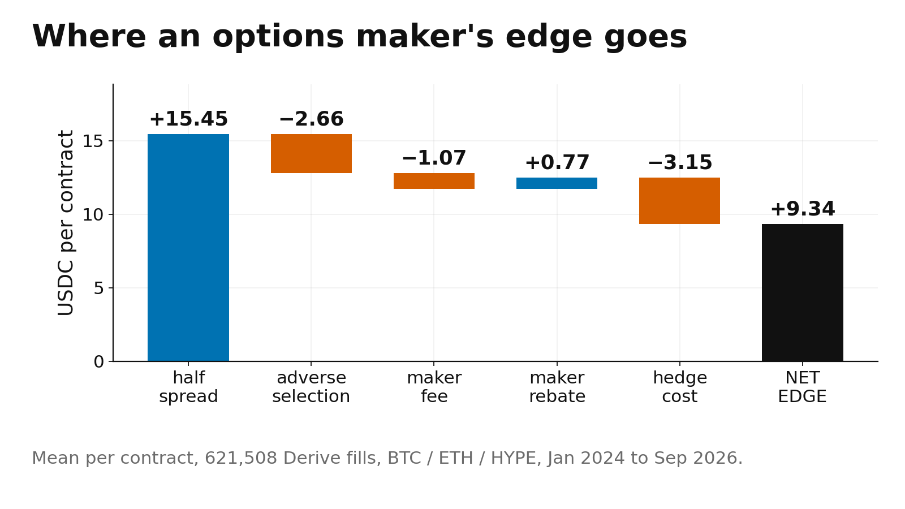

> A market maker on an options book loses to counterparties who know something and earns from those who do not, but on
> an anonymous venue the two can only be told apart by proxy. Derive settles on chain, so its public tape names both
> wallets. On 621,508 fills in BTC, ETH and HYPE options between January 2024 and September 2026, the maker's mean
> markout thirty minutes after the fill is +12.79 USDC per contract: a half spread of +15.45 plus adverse selection of
> −2.66. Fees, rebates and a modelled hedge cost leave a net edge of +9.34. The loss is concentrated: ten taker wallets
> carry 90.1 per cent of it, four of them nearly all fills of the two professional counterparty classes. Trade size, the
> standard proxy for toxic flow, explains none of it under instrument-by-day fixed effects, and sweeps predict only the
> move of the underlying, which hedging removes. Four hypotheses were registered before any markout was computed; three
> are rejected.

| | |
|---|---|
| Pre-registration | [`docs/paper1/PRAEREGISTRIERUNG.md`](docs/paper1/PRAEREGISTRIERUNG.md) (binding) · [English translation](docs/paper1/PREREGISTRATION.md) |
| Manuscript | [`papers/paper1/main.tex`](papers/paper1/main.tex) |
| Code | `src/derive_surface/`: `fulltape`, `classify`, `markpath`, `markouts`, `inference_p1`, `figures_p1`; `scripts/p1_*` |
| Results | [`results/p1/`](results/p1) |

### Paper 2 · What does the edge cost?

*Capital-adjusted market making under a public portfolio-margin engine.* Working paper, 6 October 2026 ·
[PDF](papers/paper2/Derive%20Capital-Adjusted%20Market%20Making.pdf)

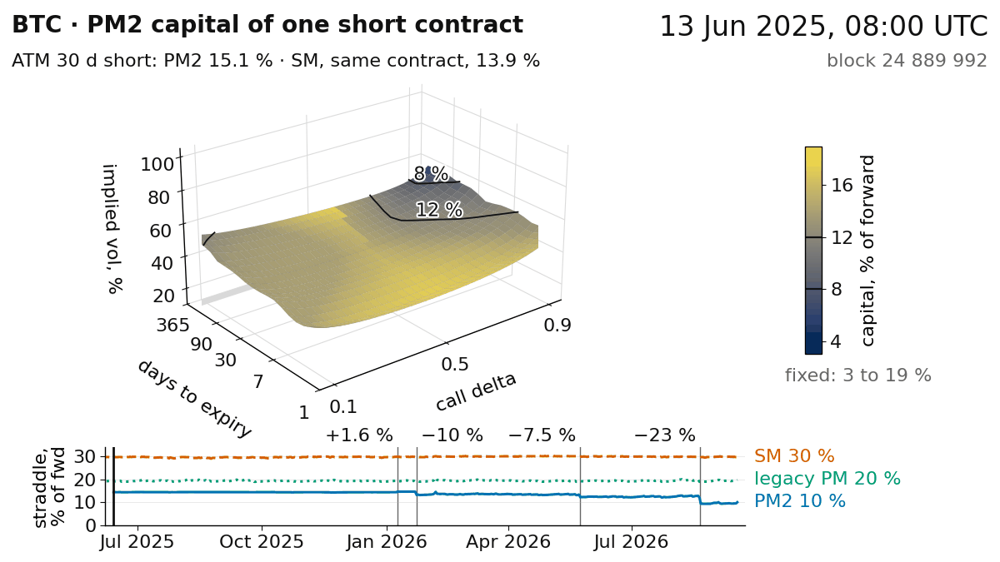

*The capital that one short BTC contract needs under the portfolio manager PM2, over the surface (delta, tenor), week
by week from June 2025 to September 2026; below, the capital of a short straddle under the three margin managers and
the parameter changes that moved it.*

> A market maker quotes against a budget of capital, not contracts, yet its edge is reported per contract. On Derive, a
> crypto options exchange, the margin rules are public smart contracts, and its off-chain engine quotes margin for any
> book. Capital is what its three margin managers require for positions, not balances; it is measured on one contract
> for each fill of a companion paper and on the books of dominant maker subaccounts. Four hypotheses were registered
> before the analysis's capital figures existed. Contrary to H1, capital does not reorder the moneyness-by-tenor map of
> the edge in the registered sense (rank correlation 0.890); post hoc, much of the correlation comes from the sign of
> the edge. In the books of the four subaccounts under the second-generation portfolio manager (PM2), trading only ETH
> and HYPE, the median fill binds 3.5 per cent of its stand-alone capital (H2 not rejected). On the opening books of
> nine dominant subaccounts, standard margin needs 4.73 times the PM2 capital (H3 not rejected), mostly for books too
> large for a standard-margin subaccount. Contrary to H4, cheaper capital did not detectably narrow the half spread; the
> test has little power. The sample ends on 30 September 2026.

| | |
|---|---|
| Pre-registration | [`docs/paper2/PRAEREGISTRIERUNG.md`](docs/paper2/PRAEREGISTRIERUNG.md) (binding, with dated addenda) · [English translation](docs/paper2/PREREGISTRATION.md) |
| Manuscript | [`papers/paper2/main.tex`](papers/paper2/main.tex) |
| Code | `src/derive_surface/`: margin replicas `margin_sm`, `margin_pm`, `margin_pm2`; `capital`, `books`; inference `inference_p2`, `inference_p2_h4`; figures `figs_p2/`; `scripts/p2_*` |
| Results | [`results/p2/`](results/p2) |
| Records | [audit](docs/paper2/AUDIT.md) · [validation of the replica](docs/paper2/VALIDATION.md) · [semantics of `get_margin`](docs/paper2/get_margin_semantics.md) · [literature check](docs/paper2/LITERATURE.md) · [history rewrites](docs/paper2/HISTORY_REWRITE.md) |

## The option surface

The surface is drawn as a 3D coordinate system *(delta, tenor, implied vol)* that moves as the underlying moves, together
with the question behind it: **which greeks actually describe that motion?** Three views, each as a GIF (MP4 next to it
in `docs/media/`):

| | What the animation shows | Data |
|---|---|---|
| **Live** | Orderbook mids and surface in real time, recorded over 1.9 h (07:33–09:30 UTC, 2026-09-03) | Top of book of **every** live option every 20 s (`get_tickers`) |
| **Tape** | How the surface travelled over the last 60 days (BTC +23 %, ETH +37 % in August) | Every fill of the trade tape (= a crossed quote) + the spot feed |
| **Shock** | The mechanics in isolation: forward ±6 %, smile shape frozen, ladder re-priced with Black-76 | The last live snapshot |

### Live: orderbook mid → surface

Top left the Derive index, bottom left the option orderbook of the front weekly (mid per strike, band = bid/ask),
right the surface fitted to **all** options at that moment. The grey dots on the surface are the fixed-strike mids it
was fitted to: on a delta axis they **slide** when spot moves, while the surface itself only shows what changes
*relative to spot*. That separation is the regime information (see [Which greeks?](#which-greeks-first-second-or-third-order)). In these two hours spot moved by only
0.6 % (BTC 77,570–78,045, ETH 2,395–2,412, HYPE 81.8–82.4), so the motion is subtle; the big moves are in the tape view below.

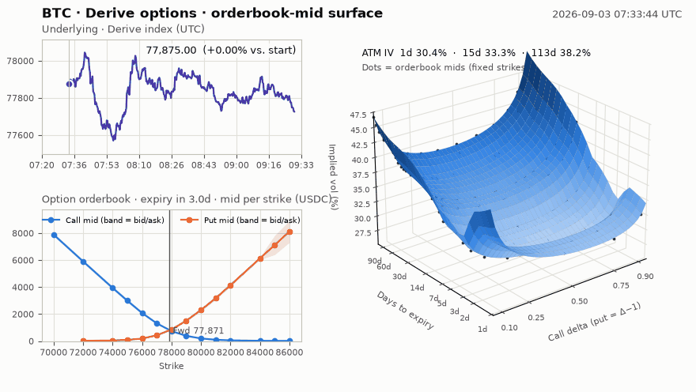

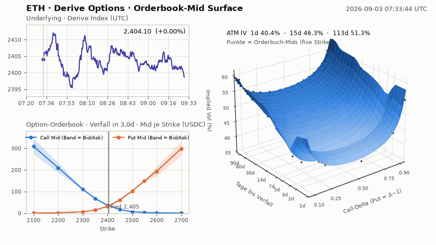

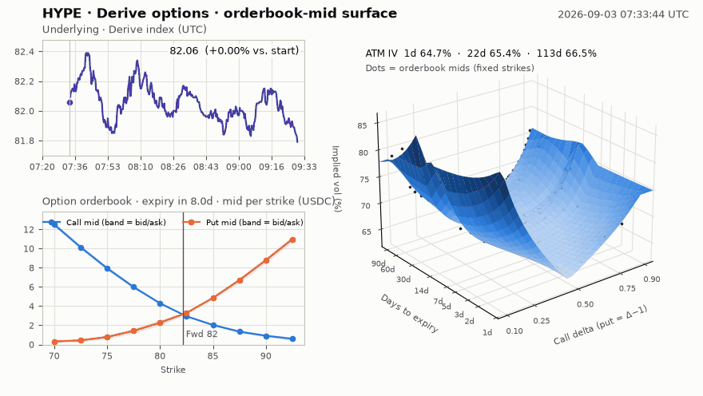

### Tape: 60 days of surface history from the trade tape

Derive keeps **no** historical orderbook snapshots (see [Data](#data)). But every fill is a point where the orderbook
demonstrably *was*. From the complete trade tape (590,378 fills since January 2024) the surface is reconstructed every
12 h: Black-76 inversion of every fill, time- and size-weighted SVI fit over a 24-hour window. Bottom left: the fills
behind the front smile.

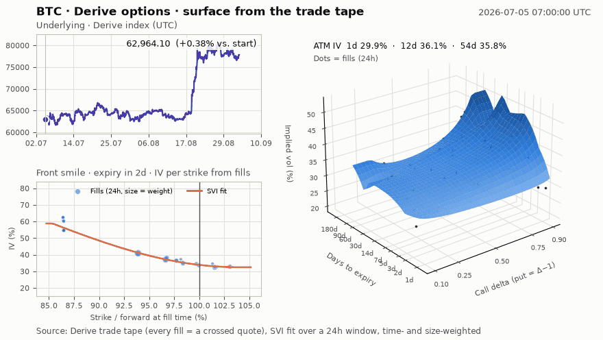

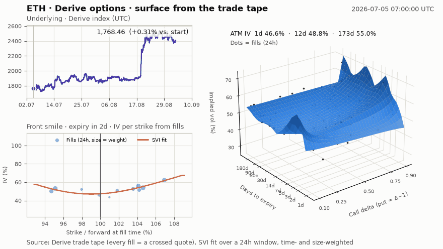

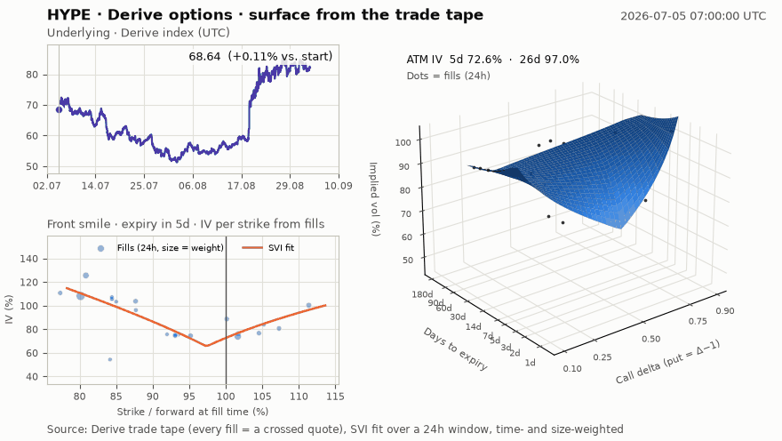

### Shock: what happens to ladder and surface when *only* spot moves

The forward sweeps ±6 %, the smile shape in moneyness stays put (regime *sticky-delta*), and every two-sided option in
the ladder is re-priced with Black-76. The surface is drawn in **strike coordinates** here so that you can see it
*slide* (in delta coordinates it would be motionless under sticky-delta by construction); nothing is drawn outside the
quoted strikes. The colour is **Δ_MV − Δ_BS = vega · ∂σ/∂S**, the amount by which a Black-Scholes delta hedge is wrong
because of the skew (see [Which greeks?](#which-greeks-first-second-or-third-order)): blue where the skew lowers the delta, red where it raises it.

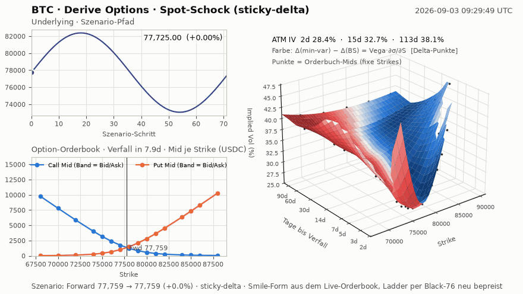

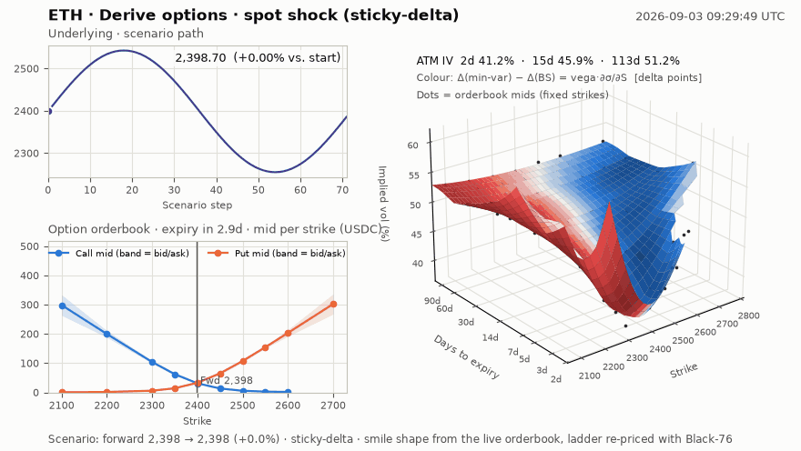

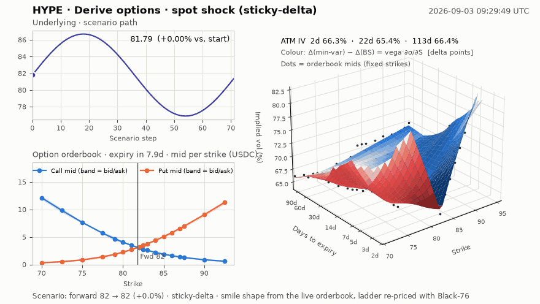

`--regime sticky_strike` renders the counterpart (vol per strike frozen, smile slides in moneyness).

## Quick start

```bash
git clone https://github.com/grzresearch/Derive-Research.git
cd Derive-Research
python -m venv .venv && source .venv/bin/activate
pip install -e ".[test]"                              # the package from src/, plus pytest

pytest -q                                             # put-call parity, IV round trip, greeks vs. finite differences, SVI recovery, both papers
```

Rebuild the data and the animations (public API only):

```bash
python -m derive_surface download BTC ETH HYPE        # complete trade tape + spot history  (~10 min)
python -m derive_surface record tickers --duration 7200 &   # top of book every 20 s
python -m derive_surface record depth   --duration 7200 &   # price levels near the money
python -m derive_surface depth-snapshot               # all resting orders of all options, now
python -m derive_surface merge

python -m derive_surface animate live  BTC                       # docs/media/BTC_live.gif + .mp4
python -m derive_surface animate live  BTC --color-by skew --suffix _skew
python -m derive_surface animate tape  ETH --days 60 --step-hours 12
python -m derive_surface animate shock HYPE --regime sticky_strike --color-by gamma
scripts/render_media.sh                               # every animation in docs/media
python scripts/readme_numbers.py                      # the figures quoted in this README, from the data on disk
```

The papers have their own command groups (`python -m derive_surface p1 --help`, `python -m derive_surface p2 --help`)
and build scripts (`scripts/p1_build.py`, `scripts/p2_build.py`; they need [tectonic](https://tectonic-typesetting.github.io)
and `pypdf`). Large intermediate data of the papers live under the git-ignored `data/p1/` and `data/p2/`.

## Repository layout

```
src/derive_surface/      the Python package
  api.py                 JSON-RPC/WebSocket client (retry, slim-ticker parser, fractional strikes like 77_5)
  history.py             trade tape (paginated, atomic, resumable) + spot feed → parquet
  recorder.py            live recorder: top of book per expiry, WebSocket depth, complete depth snapshot
  pricing.py             Black-76, IV inversion (bisection), greeks of 1st–3rd order, forward delta
  surface.py             quotes → SVI smiles → grid (delta / std / log-moneyness / strike), skew, calendar constraint
  tape.py                surfaces from the trade tape (time- and size-weighted)
  analysis.py            greek noise measure (bid vs. ask surface), skew-stickiness ratio
  animate.py, shock.py   frames (index · ladder/smile · 3D surface) → GIF/MP4; spot-shock scenarios
  fulltape.py, classify.py, markpath.py, markouts.py, inference_p1.py, figures_p1.py     Paper 1
  margin_*.py, capital.py, books.py, p2*.py, inference_p2*.py, figs_p2/, figures_p2.py   Paper 2
tests/                   pytest suite (surface, Paper 1, Paper 2) and fixtures
scripts/                 builds, number and figure checks of the papers; render_media.sh, readme_numbers.py
papers/paper1/           Paper 1: manuscript, figures, social cards, PDF
papers/paper2/           Paper 2: manuscript, figures, social cards, PDF
docs/                    API notes and media; paper1/ and paper2/: pre-registrations and the records they cite
results/                 p1/, p2/: every number of the two papers (JSON, CSV)
data/                    trade tape, spot, live recording, depth snapshot (parquet; schema in data/README.md)
pyproject.toml           package metadata, dependencies, pytest configuration
requirements.txt         the same runtime dependencies for `pip install -r` (pyproject.toml is the reference)
```

The dated records under `docs/` cite files as they were when the records were written, before the layout above:
`paper/` is now `papers/paper1/`, `paper2/` is `papers/paper2/` and `derive_surface/` is `src/derive_surface/`.

## Data

Everything comes from the public JSON-RPC/WebSocket API (`api.lyra.finance`, no wallet needed). Endpoints,
parameters and retention were verified live and are documented in [`docs/derive_api_notes.md`](docs/derive_api_notes.md);
the data schema is in [`data/README.md`](data/README.md).

| Dataset | Size | File |
|---|---|---|
| **Trade tape** BTC options | 150,957 fills, 2024-01-11 → 2026-09-03 | `data/trades/BTC_option_trades.parquet` |
| **Trade tape** ETH options | 397,656 fills, 2024-01-11 → 2026-09-03 | `data/trades/ETH_option_trades.parquet` |
| **Trade tape** HYPE options | 41,765 fills, 2025-11-10 → 2026-09-03 | `data/trades/HYPE_option_trades.parquet` |
| **Spot feed** per currency | 1 min (24 h), 5 min (7 d), 15 min (30 d), 1 h (90 d): Derive keeps nothing older | `data/spot/*.parquet` |
| **Live orderbook, top of book** | every live option (2,008 instruments), 348 cycles of 20 s: bid/ask/sizes/mark/IV/greeks/index/forward | `data/live/<CCY>_tickers.parquet` |
| **Live orderbook, depth** | price levels (up to 10 per side) of 95 near-the-money options every 10 s, 553 time slices | `data/live/depth.parquet` |
| **Current resting orders, complete** | all price levels (up to 20 per side) of **every** live option: 6,093 resting levels in 1,184 books, 2026-09-03 11:53 UTC | `data/live/depth_snapshot.parquet` |

Every fill carries `trade_price`, `mark_price` and `index_price` at fill time; maker and taker rows are de-duplicated
to the taker row (`direction` = aggressor side; `liquidity_role` marks the few fills without a taker row).

## Method

### The surface: why (delta, tenor, implied vol)

The three coordinates are the two that identify an option and the one number the whole orderbook prices it with:

* **x · forward delta** of a call (0.05 … 0.95; put delta = Δ − 1; not premium-adjusted because Derive settles in
  USDC). Delta rather than strike because only then are a 1-day and a 6-month option comparable on the same axis, and
  because that is how vol is quoted (ATM, 25Δ risk reversal, 25Δ butterfly). The delta is computed from the **fitted**
  IV, not from the mid, otherwise the axis would jitter with the spread. `--axis std` shows standardised moneyness
  k/(σ√T) instead, `--axis logm` and `--axis strike` the raw coordinates.
* **y · tenor** in days, logarithmic.
* **z · implied volatility** from the **orderbook mid**, not from the exchange mark. The mid is the price bid and ask
  currently agree on; the mark is the exchange's model.

Pipeline per timestamp (`src/derive_surface/surface.py`):

1. Top of book of all options → mid; two-sided books only, relative spread ≤ 80 %, |ln(K/F)| ≤ 1.2.
2. Only the **OTM side** of each strike (calls above, puts below the forward): that is where the liquidity is, and
   put-call parity makes the ITM side redundant.
3. **Black-76 on the forward** that Derive publishes per expiry (basis today: BTC +4 bp at 8 d, +139 bp at 113 d,
   +386 bp at 295 d; ETH +4 / +94 / +317 bp; HYPE +5 / +130 / +243 bp), with discount factor; bisection for the IV of
   mid, bid and ask. Our bid/ask IVs match Derive's own `bid_iv`/`ask_iv` to < 1 · 10⁻⁴.
4. Weight per quote = 1 / (ask IV − bid IV)²: tight books count, wide books do not disturb.
5. Per expiry a fit of **raw SVI** in total variance w(k) = a + b·(ρ(k−m) + √((k−m)² + σ²)) (robust least squares with
   a spread-relative knee, positivity, slope and degeneracy checks, quadratic/flat fallback for thin books such as
   HYPE). Beyond the last quote the smile is **held flat**, starting at most half an ATM standard deviation out: we do
   not invent wings.
6. Between expiries linear in total variance with a **calendar constraint** (total variance may not decrease in T; the
   share of lifted nodes is logged). On the delta axis via a strike ↔ delta fixed point.

### Which greeks? First, second or third order?

**Short answer:** no order of Black-Scholes greeks describes how the surface moves with the underlying. Delta belongs
on the **axis**, not on the surface. On a delta–tenor surface, gamma, vanna, volga (and all the more speed, zomma,
color, ultima) are almost deterministic functions of the coordinates (d₁, σ, T): painting them on the surface colours
in the Black-Scholes formula, not the market. The market information lives in the **derivatives of the surface
itself** (skew ∂σ/∂k, curvature) and in the **regime**, i.e. whether the surface sticks to strike or to delta when spot
moves.

That is why the colouring offers, next to every greek, two surface quantities (`--color-by skew|mvdelta`):

| Quantity | Meaning | Order |
|---|---|---|
| **skew** = ∂σ/∂k | Slope of the fitted smile: what the market actually says about direction | property of the surface |
| **mvdelta** = Δ_MV − Δ_BS = vega · ∂σ/∂S | Minimum-variance delta (Hull/White) minus Black-Scholes delta: by this many delta points the BS hedge is wrong, with ∂σ/∂S = (SSR − 1) · ∂σ/∂k / F | second order, but from the surface, not from the formula |

**First order (delta, vega, theta, rho)** describes how the *price of one option* changes. Delta is the coordinate;
vega is the lever through which any IV change passes, but it does not say where the IV change comes from.

**Second order (gamma, vanna, volga, charm)** is the right *order* for the question, but only if vanna is read as
vega × the skew of the surface rather than as a formula. That is exactly `mvdelta`. Gamma shows the convexity of the
ladder around the forward (the "kink" of the mid curves), volga the convexity in vol (the wings rise more than the
centre when vol jumps, visible in the August jump of the tape GIF).

**Third order (speed, zomma, color, ultima)** is implemented (`pricing.greeks`, `Surface.greeks_grid`) but not worth
displaying: not measurable from a DEX orderbook, and from the SVI surface only a function of five parameters per
expiry. Measured on the last live snapshots, greeks computed once from the bid-IV surface and once from the ask-IV
surface (liquid 10Δ–90Δ region; sign-changing greeks normalised to their maximum per tenor):

| Order | Greek | BTC (spread 1.35 vp) | ETH (1.53 vp) | HYPE (7.6 vp) |
|---|---|---|---|---|
| | | median (75th percentile) of the relative gap bid vs. ask surface | | |
| 1 | Delta | 1.7 % (3.4 %) | 1.7 % (3.0 %) | 6.6 % (13.1 %) |
| 1 | Vega | 0.9 % (2.2 %) | 0.9 % (2.0 %) | 3.0 % (7.8 %) |
| 1 | Theta | 2.4 % (3.4 %) | 2.5 % (3.4 %) | 11.4 % (14.2 %) |
| 2 | Gamma | 1.3 % (1.7 %) | 1.5 % (2.0 %) | 6.7 % (8.6 %) |
| 2 | Vanna | 1.6 % (2.5 %) | 1.9 % (2.5 %) | 8.9 % (11.7 %) |
| 2 | Volga | 2.2 % (3.4 %) | 2.4 % (3.6 %) | 12.5 % (17.4 %) |
| 2 | Charm | 0.6 % (1.1 %) | 0.7 % (1.1 %) | 2.9 % (5.1 %) |
| 3 | Speed | 3.0 % (4.5 %) | 3.3 % (4.6 %) | 14.8 % (19.4 %) |
| 3 | Zomma | 2.2 % (3.2 %) | 2.4 % (3.6 %) | 10.3 % (13.7 %) |
| 3 | Color | 1.6 % (2.4 %) | 1.7 % (2.5 %) | 7.0 % (10.4 %) |
| 3 | Ultima | 2.8 % (4.2 %) | 3.2 % (4.7 %) | 15.6 % (23.3 %) |

For BTC and ETH everything up to second order is signal and third order sits at roughly twice the noise. For HYPE,
with an 8-vol-point spread, even gamma and vanna are only readable from the smoothed surface; volga and anything
above it are not.

**Regime: measure it, do not assume it.** Bergomi's skew-stickiness ratio SSR = (dσ_ATM/d ln F) / (∂σ/∂k):
0 = sticky-delta (the smile rides with the forward), 1 = sticky-strike (vol per strike frozen), ≈ 2 = stochastic-vol
dynamics at the short end (equity indices: 1.5–2). From our data, by regressing ATM-vol changes on log-forward changes:

| Source | Tenor | BTC SSR (R²) | ETH SSR (R²) | HYPE SSR (R²) |
|---|---|---|---|---|
| Tape, 60 days, 12-h steps | 7 d | −1.1 (0.05) | −3.3 (0.15) | +0.7 (0.02) |
| | 30 d | −0.6 (0.01) | −1.2 (0.03) | +1.4 (0.00) |
| | 90 d | n/a (skew ≈ 0) | −0.4 (0.00) | n/a (skew ≈ 0) |
| Live, 2 h, 100-s steps | 3 d | −1.0 (0.00) | −7.4 (0.29) | −5.5 (0.05) |
| | 8 d | n/a (skew ≈ 0) | +0.4 (0.00) | n/a (skew ≈ 0) |
| | 30 d | −6.3 (0.07) | −2.4 (0.04) | −2.0 (0.01) |

n/a = undefined because the ATM skew of that tenor is close to zero and the ratio explodes.

How to read it: the R² values are small and the sign flips between tenors and windows. Over these 60 days (and the two
live hours) spot moves explain only a small part of the ATM-vol changes, and positive slopes with negative skew, as in
short-dated ETH, mean vol rising *with* spot ("vol up on up", the crypto signature in rallies), which none of the
textbook regimes captures. That is why the shock GIF shows both extremes as mechanics and the live animation carries
the fixed-strike mids as tracers: their motion *relative to the surface* is the regime.

## Limitations

* Historical orderbook states do not exist at Derive; the tape is the densest public trace. For HYPE it is thin on
  quiet days: the fit then falls back to quadratic/flat, or the expiry is skipped.
* In the tape the forward ≈ index (Derive publishes no historical forward). Today's basis is 4–5 bp for one week,
  94–139 bp for four months and up to 386 bp for ten months; for HYPE tenors beyond a month this shifts the moneyness
  axis of the tape smile by up to a few percent. Live, the real forward per expiry is used.
* Raw SVI is fitted independently per expiry; the calendar constraint only applies on the grid. A joint SSVI
  parameterisation and temporal smoothing of the parameters would further reduce frame-to-frame jitter.
* With an 8-vol-point spread (HYPE) the mid is a convention, not a measurement; the bid/ask surfaces
  (`analysis.surface_from_side`) give the band.

## Citation

```bibtex
@unpublished{albiez2026,
  author = {Albiez, Gregor},
  title  = {Who trades against the maker? {A}dverse selection with counterparty identity on an on-chain options order book},
  note   = {SSRN working paper 7496818, University of Applied Sciences and Arts Northwestern Switzerland (FHNW), revised 6 October 2026},
  year   = {2026},
  doi    = {10.2139/ssrn.7496818}
}
```

## Use of AI tools

AI assistants (Claude, Anthropic) supported this project: in searching the literature, in writing and testing code, in cross-checking results and in drafting and editing the text. The research question, the design of the study and the interpretation of the results are the author's; the author directed the work, reviewed its results and takes full responsibility for the papers and this repository.
